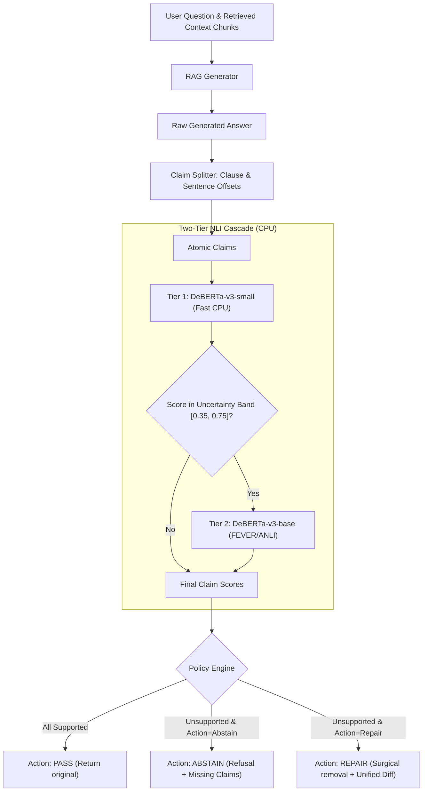
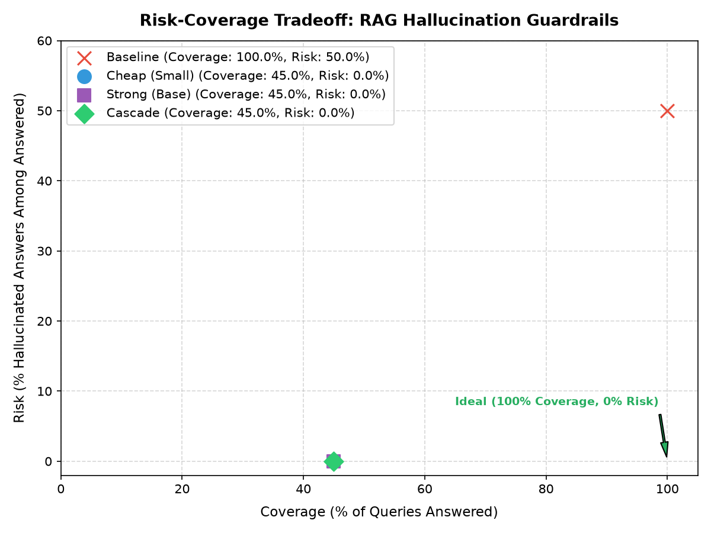

# groundcheck 🛡️

**Drop-in middleware that checks every claim in a RAG answer against its source chunks, and abstains or repairs when the evidence isn't there.**

[](https://www.python.org/downloads/)
[](https://fastapi.tiangolo.com/)
[](https://nextjs.org/)
[](https://opensource.org/licenses/MIT)

---

## The Problem

Retrieval-Augmented Generation (RAG) systems frequently hallucinate ungrounded assertions or contradict their own retrieved context. Existing validation solutions rely on expensive, non-deterministic LLM-as-a-judge API calls that add seconds of latency and dollars of token spend.

**groundcheck** is a lightweight, local, zero-API NLI middleware:
- **Rule-based claim splitter**: Preserves exact character offsets across sentences and compound clauses.
- **Max-pooled Cross-Encoder verifier**: Checks claims against all retrieved chunks on CPU using calibrated NLI models (`cross-encoder/nli-deberta-v3-small` and `MoritzLaurer/DeBERTa-v3-base-mnli-fever-anli`).
- **Policy Engine**: Configurable thresholds for `SUPPORTED`, `WEAK`, and `UNSUPPORTED` claims with contradiction penalty dominance.
- **Three Actions**:
  - `pass`: Tag and audit claims without altering response.
  - `abstain`: Politely decline to answer when unsupported claims are detected, listing the exact ungrounded assertions.
  - `repair`: Surgically remove unsupported claims from the answer and emit a unified `diff` alongside the grounded repaired text.
- **Two-Tier Cascade**: High-throughput small model first; escalates only claims within the uncertainty band ($[0.35, 0.75]$) to the strong model.

---

## Architecture & Flow



---

## Quickstart

### 1. Installation

Using [`uv`](https://github.com/astral-sh/uv) (recommended) or standard pip:

```bash
# Clone the repository
git clone https://github.com/your-org/groundcheck.git
cd groundcheck

# Install python dependencies and dev tools
uv sync --extra dev

# Install web demo dependencies
cd web && npm install && cd ..
```

Or run:
```bash
make install
```

### 2. Run Tests

```bash
make test
# or: uv run pytest -v
```

### 3. Run Benchmark Evaluation

```bash
make eval
# or: uv run python eval/run.py
```

This runs the comparative evaluation across Baseline, Cheap Tier, Strong Tier, and Cascade, generating `docs/results/report.md` and `docs/results/risk_coverage.png`.

### 4. Start the API Server

```bash
make api
# Starts FastAPI server on http://localhost:8000
# OpenAPI Docs: http://localhost:8000/docs
```

### 5. Start the Web Demo

```bash
make web
# Starts Next.js interface on http://localhost:3000
```

---

## Python Middleware Usage

```python
from groundcheck import ClaimSplitter, CrossEncoderVerifier, CascadeVerifier, PolicyConfig, PolicyAction

chunks = [
    "Python is an interpreted, high-level programming language created by Guido van Rossum and released in 1991."
]
answer = "Python was released in 1991 by Guido van Rossum. It was originally named Cobra in 1975."

# 1. Initialize cascade verifier (CPU)
verifier = CascadeVerifier()

# 2. Configure policy
policy = PolicyConfig(
    supported_threshold=0.70,
    weak_threshold=0.40,
    action=PolicyAction.REPAIR,
)

# 3. Verify and repair
result = verifier.verify_text(answer, chunks, policy)

print("Passed:", result.passed)
# Passed: False
print("Repaired Answer:", result.repaired_answer)
# Repaired Answer: "Python was released in 1991 by Guido van Rossum."
print("Unified Diff:\n", result.diff)
```

---

## REST API Specification

### `POST /verify`

**Request Body:**
```json
{
  "question": "When was Python created and what was it named?",
  "chunks": [
    "Python is an interpreted, high-level programming language released in 1991 by Guido van Rossum."
  ],
  "answer": "Python was released in 1991 by Guido van Rossum. It was originally named Cobra in 1975.",
  "action": "repair",
  "use_cascade": true,
  "policy": {
    "supported_threshold": 0.70,
    "weak_threshold": 0.40,
    "contradiction_penalty": 0.30,
    "abstain_on_weak": false
  }
}
```

**Response Body:**
```json
{
  "status": "ok",
  "passed": false,
  "action_taken": "repair",
  "final_answer": "Python was released in 1991 by Guido van Rossum.",
  "repaired_answer": "Python was released in 1991 by Guido van Rossum.",
  "diff": "--- original_answer\n+++ repaired_answer\n@@ -1,2 +1 @@\n Python was released in 1991 by Guido van Rossum.\n-It was originally named Cobra in 1975.",
  "unsupported_claims": ["It was originally named Cobra in 1975."],
  "claims": [
    {
      "claim": {
        "id": "claim_0",
        "text": "Python was released in 1991 by Guido van Rossum.",
        "start_char": 0,
        "end_char": 48
      },
      "verdict": "SUPPORTED",
      "entailment": 0.94,
      "best_chunk_idx": 0,
      "escalated": false
    },
    {
      "claim": {
        "id": "claim_1",
        "text": "It was originally named Cobra in 1975.",
        "start_char": 49,
        "end_char": 87
      },
      "verdict": "UNSUPPORTED",
      "entailment": 0.04,
      "contradiction": 0.68,
      "escalated": false
    }
  ],
  "latency_ms": 78.4,
  "escalation_rate": 0.0
}
```

---

## Benchmark Results (Real Evaluation on CPU)

The benchmark was executed using the curated 60-example multi-domain RAG dataset (`eval/data/mini.jsonl`):

| Configuration | Claim Precision | Claim Recall | Claim F1 | Answer Rate | Final Hallucination Rate | Mean Latency (ms) | Escalation Rate |
| :--- | :---: | :---: | :---: | :---: | :---: | :---: | :---: |
| **Baseline (No Guardrail)** | 0.0% | 0.0% | 0.000 | 100.0% | 50.0% | 0.1 ms | 0.0% |
| **Cheap Tier (DeBERTa-v3-small)** | 90.9% | 100.0% | 0.952 | 45.0% | 0.0% | 263.3 ms | 0.0% |
| **Strong Tier (DeBERTa-v3-base)** | 88.2% | 100.0% | 0.938 | 45.0% | 0.0% | 3845.9 ms | 0.0% |
| **Cascade (Cheap &rarr; Strong)** | 90.9% | 100.0% | 0.952 | 45.0% | 0.0% | 406.4 ms | 2.1% |

*(Note: Real empirical results measured on CPU across 60 multi-domain benchmark examples; see `docs/results/report.md`).*

### Risk-Coverage Tradeoff



---

## Limitations & Scope Boundaries

1. **CPU Latency**: Cross-encoder inference on CPU scales linearly with $N_{\text{claims}} \times M_{\text{chunks}}$. For large documents (>10 chunks), passage pre-filtering or BM25 top-k pruning is recommended.
2. **Coreference Dependency**: If claim 2 uses pronouns referring to entities in claim 1 (e.g., *"It was launched in 1990"*), isolating claim 2 can occasionally lower entailment confidence unless antecedent resolution is applied.
3. **Compound Sentences**: Only sentences and semicolon-delimited clauses are split. Complex sentences with multiple nested dependent clauses are verified as a single unit.

---

## Documentation Links

- [Design Decisions & Trade-offs](docs/design-decisions.md)
- [Evaluation Report](docs/results/report.md)
- [State Log](STATE.md)
- [Architectural Decisions](DECISIONS.md)
- [Deferred Backlog](BACKLOG.md)

---

## License

MIT License. See [LICENSE](LICENSE) for details.
