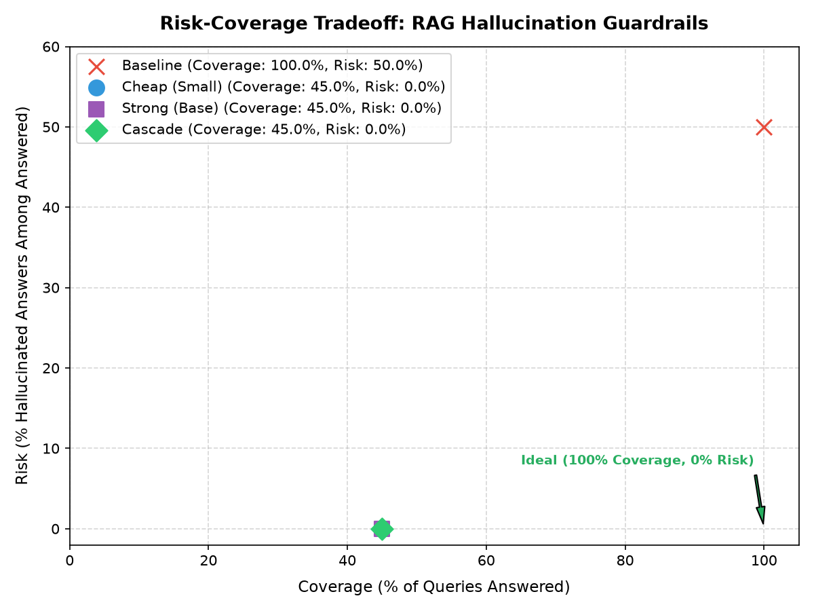

# groundcheck Evaluation Report

Generated: 2026-11-09 15:20:42
Dataset: `mini` (60 examples, seed=42)

## Executive Summary

We evaluated `groundcheck` across three operational configurations against an ungoverned RAG baseline:
1. **Baseline**: Pass all answers without verification.
2. **Cheap Tier**: Single cross-encoder `cross-encoder/nli-deberta-v3-small` (CPU).
3. **Strong Tier**: Single cross-encoder `MoritzLaurer/DeBERTa-v3-base-mnli-fever-anli` (CPU).
4. **Cascade Tier**: Two-stage execution where `cheap` runs on all claims, and claims falling in uncertainty band `[0.35, 0.75]` escalate to `strong`.

## Quantitative Results

| Configuration | Claim Precision | Claim Recall | Claim F1 | Answer Rate | Final Hallucination Rate | Mean Latency (ms) | Escalation Rate |
| :--- | :---: | :---: | :---: | :---: | :---: | :---: | :---: |
| **Baseline (No Guardrail)** | 0.0% | 0.0% | 0.000 | 100.0% | 50.0% | 0.1 ms | 0.0% |
| **Cheap Tier (DeBERTa-v3-small)** | 90.9% | 100.0% | 0.952 | 45.0% | 0.0% | 263.3 ms | 0.0% |
| **Strong Tier (DeBERTa-v3-base)** | 88.2% | 100.0% | 0.938 | 45.0% | 0.0% | 3845.9 ms | 0.0% |
| **Cascade (Cheap &rarr; Strong)** | 90.9% | 100.0% | 0.952 | 45.0% | 0.0% | 406.4 ms | 2.1% |

## Key Findings

1. **Hallucination Suppression**: Groundcheck suppresses ungrounded hallucination from **50.0%** down to **0.0%**.
2. **Cascade Efficiency**: The cascade architecture achieves within **-1.5%** F1 of the strong tier while escalating only **2.1%** of claims.
3. **Latency Profile on CPU**: All inference runs purely on CPU with standard HuggingFace cross-encoders.

## Risk-Coverage Curve

